# Hydrowise

**HackNation 2026 · zadanie KOWR „Zatrzymaj wodę, chroń plony – inteligentne wsparcie gospodarowania wodą w rolnictwie”**

Rolnik wskazuje działkę ewidencyjną i dzień. Aplikacja pobiera publiczne dane o tej działce (bieżące i z 10 lat),
liczy z nich sytuację wodną i daje plan działań w kolejności KOWR: **zatrzymaj wodę → na polu → nawadnianie**.
Każde zalecenie ma miejsce na mapie działki, termin i uzasadnienie liczbami z tej działki. Działa w przeglądarce
i na telefonie, bez logowania i bez danych osobowych.

| | |
|---|---|
| Działająca wersja | https://asystent-wodny-888051665742.europe-central2.run.app |
| API backendu (Swagger) | https://asystent-backend-888051665742.europe-central2.run.app/docs |
| Prezentacja (PDF) | [prezentacja/Hydrowise_prezentacja.pdf](prezentacja/Hydrowise_prezentacja.pdf) |

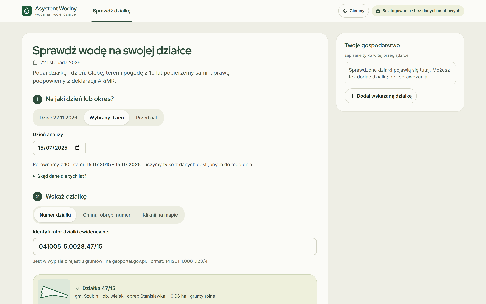

---

## 1. Instrukcja uruchomienia

**Online:** otwórz https://asystent-wodny-888051665742.europe-central2.run.app w Chrome, Firefox, Edge, Safari lub
Operze. Przykład: działka `041005_5.0028.47/15` (gm. Szubin), dzień `15.07.2025`.

**Lokalnie** (Python 3.10+, Node.js 24, pnpm przez `corepack`):

```bash
# backend – API analizy (http://localhost:8000, dokumentacja: /docs)
cd backend
pip install -r requirements.txt
python -m uvicorn app.main:app --port 8000

# frontend – aplikacja (http://localhost:3000), w drugim terminalu
cd frontend
corepack pnpm install
corepack pnpm dev
```

- Frontend łączy się z backendem przez `BACKEND_URL` (domyślnie `http://127.0.0.1:8000`).
- Opcjonalnie `backend/.env` z `CDSE_CLIENT_ID` i `CDSE_CLIENT_SECRET` (bezpłatne konto Copernicus Data Space).
  Bez nich zdjęcia satelitarne idą z Microsoft Planetary Computer, a mapa upraw Copernicus (2017–2024) jest niedostępna.
- W Dockerze: `docker compose up dev` w `backend/` i w `frontend/` (dwa terminale).
- Wdrożenie na Google Cloud Run: `./deploy.sh` (buduje obrazy z zacommitowanego kodu, wdraża i sprawdza oba serwisy;
  klucze CDSE są w Secret Manager). Cache backendu (pogoda, zdjęcia satelitarne, DEM, zlewnie) leży w buckecie
  `gs://asystent-wodny-hn26-cache` zamontowanym jako `.cache` – dane pobrane raz zostają dla wszystkich instancji
  i wdrożeń, więc nowa instancja nie wyczerpuje darmowego limitu Open‑Meteo. `deploy.sh` sam zakłada bucket
  (pliki starsze niż 180 dni są usuwane) i daje kontu usługi backendu prawo zapisu.

---

## 2. Podstawowe funkcjonalności

| Wymaganie KOWR (3.3) | Jak to robimy |
|---|---|
| Uruchomienie w przeglądarce | aplikacja webowa (PWA), komputer i telefon, bez instalacji |
| Działka lub lokalizacja na mapie | identyfikator EGiB; gmina + obręb + numer; kliknięcie na mapie z siatką działek ewidencyjnych (działka pod kursorem podświetla się na bieżąco) |
| Wybór uprawy | podpowiedź z deklaracji ARiMR (2025–26) lub mapy Copernicus (2017–24), z podziałem działki na części; gdy żadne źródło nic nie zna – „Brak uprawy”; rolnik może każdą część zmienić |
| Ocena bieżąca i z 10 lat | stan na dzień D + historia 10 sezonów, każdy oceniony dla uprawy, która wtedy rosła |
| Raport | stan i pewność wyniku, przyczyny, zalecenia (retencja, agrotechnika, nawadnianie), scenariusze, źródła z datami, „czego nie sprawdziliśmy” |
| Zapis i wydruk | „Drukuj / zapisz PDF”, link do raportu, lista działek „Twoje gospodarstwo” w przeglądarce |
| Dowolna data z 10 lat | każde źródło liczone „do dnia D”; dla dat archiwalnych zamiast prognozy średnia z 10 lat |

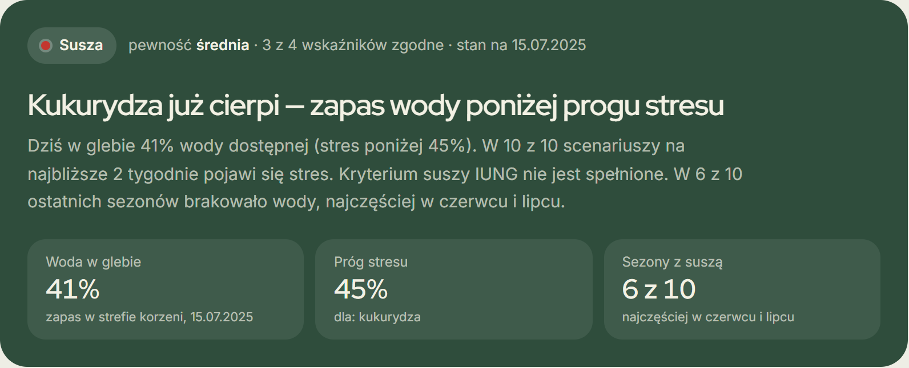

<table>
<tr>
<td width="50%">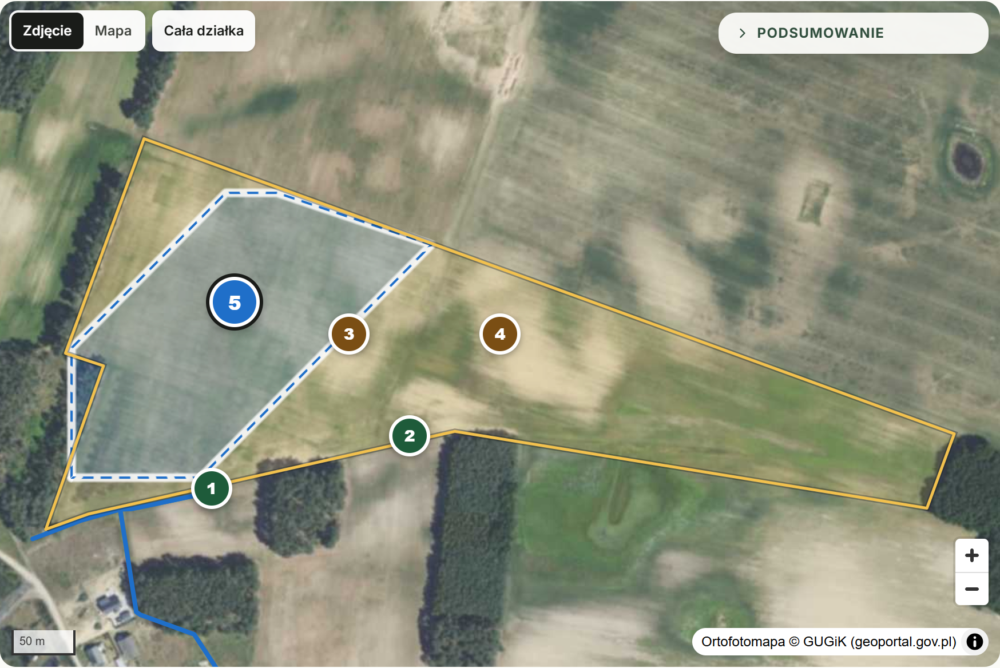<br><sub>Plan działań: numery jak na liście zaleceń</sub></td>
<td width="50%">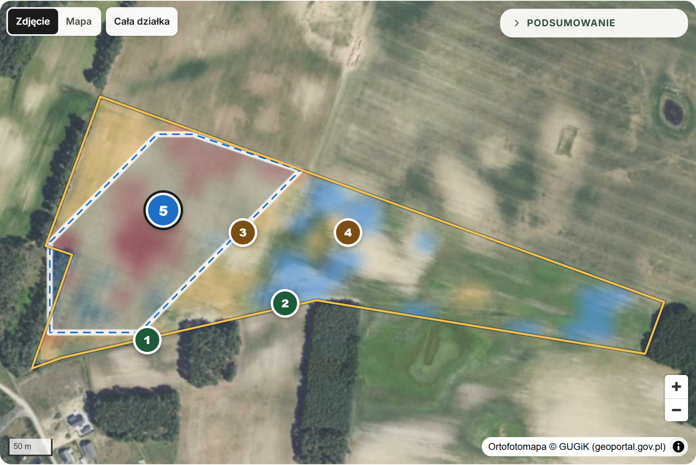<br><sub>Gdzie sucho: NDMI względem lat z tą samą uprawą</sub></td>
</tr>
<tr>
<td>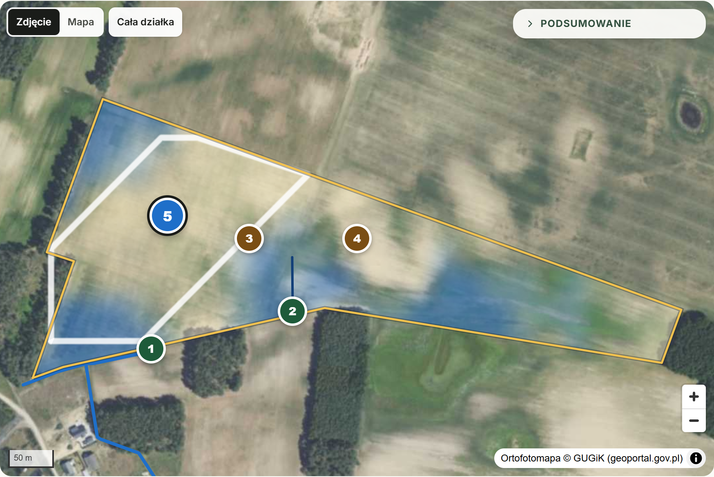<br><sub>Teren i spływ</sub></td>
<td>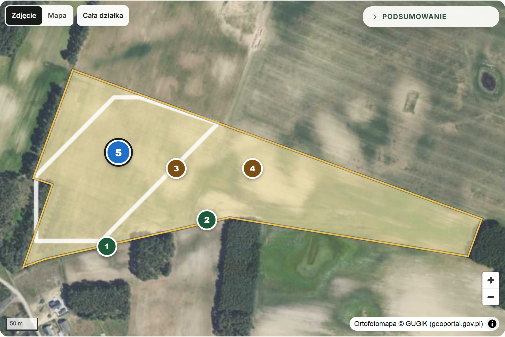<br><sub>Gleba: ile wody utrzyma strefa korzeni</sub></td>
</tr>
</table>

<table>
<tr>
<td width="40%">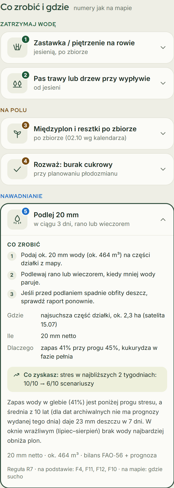</td>
<td>

**Każde działanie ma:**
- numer jak na mapie i grupę (zatrzymaj wodę / na polu / nawadnianie);
- termin, miejsce i (przy nawadnianiu) dawkę w mm i m³;
- „Dlaczego”: liczby z tej działki;
- „Co zyskasz”: efekt w tych samych 10 scenariuszach, np. stres w 2 tygodniach 10/10 → 6/10;
- numer reguły i fakty, na których się opiera.

Gdy podlewanie byłoby stratą wody, raport mówi wprost: „Nie podlewaj teraz”.

</td>
</tr>
</table>

---

## 3. Architektura

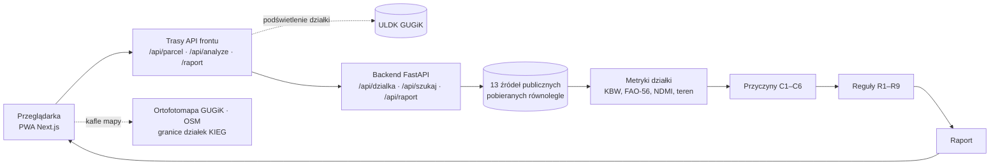

- **Frontend** (`frontend/`, Next.js 16, TypeScript, Tailwind 4, MapLibre GL): start, mapa wyboru działki, raport.
  Przeglądarka nie łączy się z backendem bezpośrednio, tylko przez trasy API frontu.
- **Backend** (`backend/app/`, Python, FastAPI): przy każdej analizie pobiera dane, liczy metryki, przyczyny
  i reguły. Każde źródło zwraca dane albo jawny brak z powodem; wolne źródła mają limit czasu (7–12 s) i ich brak
  trafia do raportu zamiast go blokować. Cache dyskowy przyspiesza powtórki, ale nie zmienia obliczeń.
- **Wdrożenie:** dwa kontenery na Google Cloud Run (region Warszawa), sekrety w Secret Manager.

**Jak liczymy** (wzory i progi: [METODY.md](METODY.md), [pipeline_plan.md](pipeline_plan.md)):

<table>
<tr>
<td width="33%">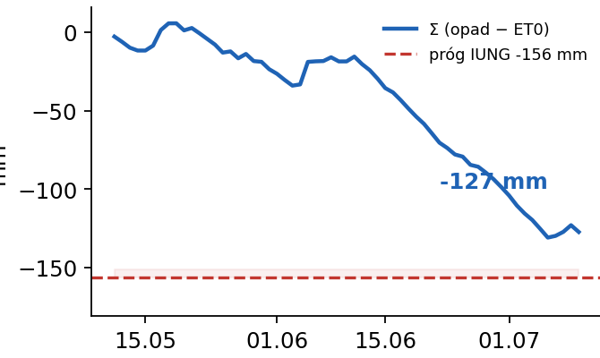</td>
<td width="33%">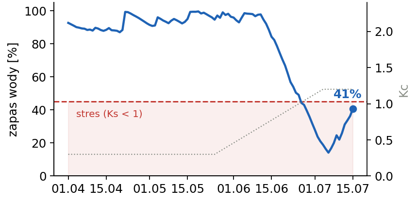</td>
<td width="33%">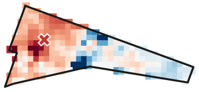</td>
</tr>
<tr>
<td><b>KBW względem progu IUNG:</b> Σ(opad − ET0) w 60 dniach wobec progu suszy dla uprawy i kategorii gleby
(metoda SMSR IUNG‑PIB).</td>
<td><b>Zapas wody w korzeniach:</b> bilans dobowy FAO‑56 z odpływem SCS‑CN wobec progu stresu rośliny.</td>
<td><b>Odchylenie NDMI:</b> z‑score tylko względem sezonów z tą samą grupą upraw; przy mniej niż 3 takich
sezonach nie oceniamy.</td>
</tr>
</table>

Scenariusze „jak bywało”: dzisiejszy zapas wody w glebie + pogoda z tych samych tygodni 10 poprzednich lat;
liczymy, w ilu scenariuszach roślina wpada w stres bez działań i z planem. Zalecenie pojawia się tylko, gdy dane
działki spełniają warunek reguły:

| Reguła | Działanie | Warunek (w skrócie) |
|---|---|---|
| R1 | zastawka na rowie | rów ≤ 100 m od granicy i susza teraz lub często |
| R2 | oczko w zagłębieniu | zagłębienie ≥ 100 m³, co najmniej 30% na działce |
| R3 | pas trawy lub drzew przy wypływie | spadek > 3% lub > 10% deszczu z ulew spływa |
| R4 | nie odwadniaj torfu | gleba organiczna na ≥ 30% działki |
| R5 | międzyplon i resztki po zbiorze | lekka gleba, ryzyko ≥ 30% lub węgiel organiczny < 1,5% |
| R6 | uprawa w poprzek stoku | średni spadek > 5% |
| R7 | podlej teraz (dawka w mm i m³) | zapas < próg stresu, niedobór > 10 mm mimo prognozy, okno wrażliwe uprawy |
| R8 | przygotuj nawadnianie | dziś nie trzeba, ale ryzyko w scenariuszach ≥ 30% |
| R9 | rozważ inną uprawę | susza w ≥ 6 z 10 sezonów dla obecnej uprawy |

**Skalowalność (5.5).** Źródła są pobierane równolegle; zmierzone przez zespół ok. 17 s na pełną analizę bez cache
(22.11.2026) i 2,5–9 s z częściowym cache. Ograniczamy liczbę zapytań: pogoda w siatce 0,05° (sąsiednie działki
dzielą zapytanie), dane IMGW raz na cały kraj co 30 min, dane stałe (zlewnie, BDOT10k, mapa upraw, NMT) w cache.
Przy wielu rolnikach potrzebne byłyby: płatny plan Open‑Meteo albo własna instancja z ERA5‑Land, wspólny cache
dla wszystkich instancji (np. Cloud Storage lub Redis), zapis wyników i cotygodniowe odświeżanie działek
z gospodarstwa w sezonie.

**Koszty i bezpieczeństwo (5.4, 5.6).** Dla rolnika bezpłatnie, bez konta. Płatny jest tylko hosting Cloud Run
(za czas działania), a przy skali krajowej także plan Open‑Meteo i miejsce na cache. Nie zbieramy danych osobowych;
lista działek gospodarstwa jest tylko w przeglądarce. Wejście jest walidowane (format działki, Polska, data
z 10 lat), sekrety są poza kodem, kontener backendu działa bez uprawnień administratora.

---

## 4. Źródła i zakresy danych

| Kategoria | Dane | Źródło | Zakres w analizie |
|---|---|---|---|
| przestrzenne | granice, gmina, obręb | ULDK GUGiK | stan obecny |
| przestrzenne | siatka działek i podkład mapy | KIEG i ortofotomapa GUGiK, OpenStreetMap | stan obecny, tylko do wyświetlania |
| przestrzenne | teren | Copernicus DEM 30 m; NMT 1 m GUGiK (w tle) | stan obecny |
| przestrzenne | uprawa w danym roku | ARiMR GSA (2025–26), Copernicus CLMS Crop Types (2017–24) | rok D i 10 sezonów wstecz |
| meteorologiczne | opad, ET0, temperatura dobowo | Open‑Meteo (ERA5‑Land) | 11 lat przed D (10 sezonów + rok na rozruch bilansu wody w glebie) |
| meteorologiczne | prognoza | Open‑Meteo Forecast | 16 dni, tylko gdy D = dziś |
| satelitarne | wilgotność roślin NDMI | Sentinel‑2 L2A (Sentinel Hub / CDSE, zapas: Planetary Computer), Landsat 5/7/8/9 | ok. 20 dni przed D + te same dni w latach odniesienia |
| glebowe | kategoria podatności na suszę | IUNG‑PIB WMS `katgl_landuse2024` | stan obecny |
| glebowe | progi suszy KBW | IUNG‑PIB, Rozp. MRiRW z 11.04.2019 | tabela w repozytorium |
| glebowe | skład gleby | ISRIC SoilGrids 250 m | stan obecny |
| hydrologiczne | rowy, cieki, zbiorniki | BDOT10k GUGiK | stan obecny |
| hydrologiczne | zlewnia cieku | MPHP10k, Wody Polskie | stan obecny |
| hydrologiczne | stany rzek, ostrzeżenia o suszy hydrologicznej | IMGW‑PIB | tylko bieżące |
| tło suszowe | Combined Drought Indicator | EDO (Copernicus) | dekada obejmująca D |

Szczegóły i plan awaryjny dla każdego źródła: [ZRODLA_DANYCH.md](ZRODLA_DANYCH.md).

---

## 5. Dane bieżące i przygotowane wcześniej

**Na bieżąco, przy każdej analizie:** wszystkie źródła z pkt 4 poza progami IUNG. Wynik i zalecenia oblicza
aplikacja z tych danych w chwili analizy; cache przyspiesza powtórki, ale nie zmienia obliczeń.

**Przygotowane wcześniej** (parametry metod, nie dane o działkach):

| Plik | Zawartość | Źródło | Data |
|---|---|---|---|
| [`dane/kbw_progi_iung.csv`](dane/kbw_progi_iung.csv) | progi KBW dla upraw i kategorii gleb | IUNG‑PIB, Rozp. MRiRW z 11.04.2019 | 21.11.2026 |
| [`backend/app/crops.py`](backend/app/crops.py) | parametry upraw (Kc, korzenie, okna wrażliwe) | FAO‑56 i literatura z [METODY.md](METODY.md) | 21–22.11.2026 |
| [`backend/app/config.py`](backend/app/config.py) | progi reguł R1–R9, limity czasu źródeł | wartości robocze zespołu | 21–22.11.2026 |

---

## 6. Biblioteki, usługi i AI

- **Backend:** FastAPI, uvicorn, httpx, numpy, Pillow, rasterio, pyproj, shapely, remotezip, pytest.
- **Frontend:** Next.js 16, React 19, MapLibre GL 5, Tailwind CSS 4, TypeScript; fonty Inter i Red Hat Display.
- **Usługi:** źródła z pkt 4, Sentinel Hub (konto CDSE), Microsoft Planetary Computer, Google Cloud Run,
  Artifact Registry, Secret Manager.
- **AI w wyniku: brak modeli językowych.** Diagnoza i zalecenia to deterministyczne obliczenia i reguły na danych;
  każde zalecenie da się prześledzić do liczb. Jedyny produkt uczenia maszynowego to mapa upraw Copernicus CLMS,
  użyta jako dana wejściowa.
- **AI przy tworzeniu:** kod i dokumentację pisano z pomocą Claude Code (Anthropic); wyniki sprawdzono testami
  i ręcznie (pkt 9).

---

## 7. Licencje i warunki korzystania

| Źródło | Warunki |
|---|---|
| GUGiK (ULDK, KIEG, ortofotomapa, NMT, BDOT10k) | dane PZGiK, bezpłatnie (Pgik art. 40a); atrybucja „GUGiK” |
| Open‑Meteo | CC BY 4.0; darmowe API do użytku niekomercyjnego; ERA5 © ECMWF / Copernicus |
| IMGW‑PIB | „Źródłem pochodzenia danych jest IMGW‑PIB”; dane przetworzone |
| Copernicus (Sentinel, CLMS, DEM, EDO) | otwarty dostęp (rozp. UE 1159/2013), atrybucja Copernicus |
| Landsat (USGS) | domena publiczna |
| ISRIC SoilGrids | CC BY 4.0 |
| IUNG‑PIB, ARiMR, Wody Polskie | dane publiczne z atrybucją instytucji; warunki ponownego użycia WMS IUNG i ARiMR do potwierdzenia |
| OpenStreetMap | ODbL, „© OpenStreetMap contributors” |

Biblioteki: open source (MIT: FastAPI, Next.js, React, Tailwind, pyproj, remotezip, pytest; BSD: numpy, httpx,
rasterio, shapely, uvicorn, MapLibre GL; Pillow: MIT‑CMU; TypeScript: Apache 2.0); fonty: SIL Open Font License.
Pełna tabela atrybucji: [ZRODLA_DANYCH.md](ZRODLA_DANYCH.md) §8.

---

## 8. Znane ograniczenia

- **Pogoda:** ERA5‑Land ma oczko ok. 9 km, więc nie rozróżnia sąsiednich działek; w obrębie działki wynik
  różnicują gleba, teren i satelita.
- **Daty archiwalne:** granice, rowy, teren i gleby są w stanie obecnym; prognozy z tamtego dnia nie ma, więc
  używamy średniej z 10 lat.
- **Satelita:** przy mniej niż 3 sezonach z tą samą grupą upraw, chmurach lub polu bez roślin nie oceniamy stanu
  roślin; przed 2018 r. zwykle brakuje lat odniesienia.
- **Uprawa w historii:** znana dla 2017–2026; wcześniej przyjmujemy bieżącą (oznaczone gwiazdką).
- **Bilans FAO‑56:** bez wód gruntowych, drenowania i jesiennego wysiewu kolejnej uprawy.
- **Teren:** pierwszy raport z DEM 30 m; NMT 1 m pobiera się w tle (1–3 min) i jest używany przy kolejnym raporcie.
- **Hydrologia:** stany rzek i ostrzeżenia IMGW tylko bieżące, dopasowane po województwie.
- **Progi reguł** są robocze, jeszcze nie kalibrowane z ekspertami.
- **Limit Open‑Meteo:** po przekroczeniu limitu zapytań raport mówi „Brak danych pogodowych (HTTP 429)” i nie liczy
  oceny. Wszystkie analizy z Cloud Run idą z tej samej puli adresów (zaobserwowane 21 i 22.11.2026).
- **Mapa wyboru:** siatka działek KIEG dopiero od zoomu 12,5 (usługa rysuje granice od ok. 1,2 m na piksel);
  przy oddalonej mapie kafle przychodzą po ok. 3 s.

---

## 9. Weryfikacja wyników

- **Testy jednostkowe** (`cd backend && python -m pytest -q`, bez sieci): progi IUNG, KBW, SCS‑CN, bilans FAO‑56,
  wybór lat odniesienia satelity, podział działki na uprawy i scalanie części (uprawa + „Brak uprawy”),
  parsowanie MPHP i IMGW.
- **Notebook** [`notebooks/pipeline_dzialka.ipynb`](notebooks/pipeline_dzialka.ipynb): każdy krok obliczeń
  dla jednej działki liczony ręcznie i porównany z wynikiem backendu.
- **Prawdziwe działki** (21–22.11.2026):
  - Szubin `041005_5.0008.57/11`, 15.07.2018, kukurydza: susza 2018, kryterium IUNG spełnione, zalecenie podlania;
  - Szubin `041005_5.0028.47/15`, 15.07.2025, kukurydza: zapas 41% przy progu 45%, susza w 6 z 10 sezonów,
    podlanie 20 mm najsuchszych 2,3 ha;
  - Krzywda `061104_2.0001.100`, 21.11.2026, pszenica: poza sezonem, 3 z 10 sezonów z suszą, ostrzeżenie IMGW
    o suszy hydrologicznej w zlewni Wieprza;
  - Gołcza `120802_2.0005.347/4`, 20.06.2022: działka podzielona na rzepak 1,0 ha, łąkę 0,25 ha i część bez
    uprawy 0,11 ha; status „Susza” (rzepak poniżej progu stresu), część bez uprawy bez zaleceń polowych.
- **Pewność w raporcie:** wynik zestawia cztery niezależne sygnały (woda w glebie, KBW, satelita, EDO); gdy się
  rozjeżdżają lub brakuje danych, raport obniża pewność i mówi dlaczego.
- **Do zrobienia:** porównanie z tabelami suszy SMSR IUNG dla gmin i EDO na latach 2018–2019, kalibracja progów
  z ekspertami.
